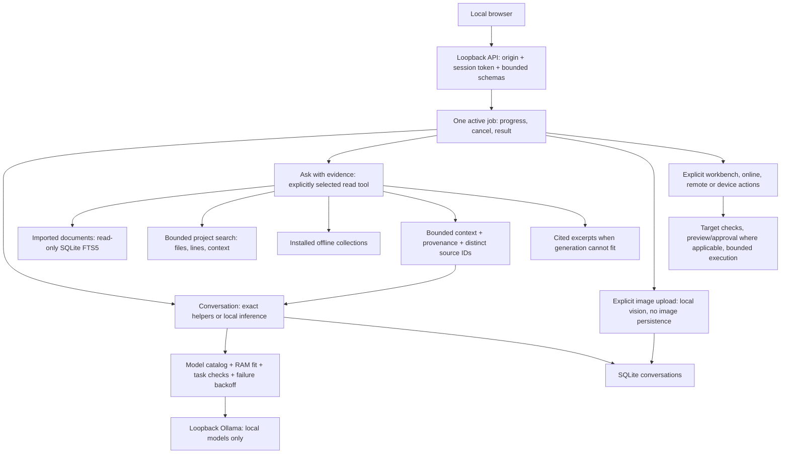

# Prometheus architecture — 0.8.0.dev2

Prometheus is a local application around interchangeable model and tool adapters.
Its portable SSD contains signed application releases, resources/models and user
data. Host-specific environments, credentials and development tools belong on
each computer. Moving the SSD must not require a fixed drive letter.

## Request paths

The CLI also exposes the multi-step Core/agent path through `core.py`, `agent.py`,
`orchestration.py`, `guardrails.py`, `tool_registry.py` and `builtin_tools.py`.
The UI uses `compact_chat.py` for ordinary chat: one model call per attempt and at
most two eligible attempts. It does not run a second planning model or dispatch
tools from model-produced strings.

## Boundaries and ownership

- `ui_server.py`: local HTTP validation, one-worker scheduling, cancellation,
  source selection and persistence. The browser renders source/model text as
  text. Origin/session checks also protect `/api/capabilities`.
- `capabilities.py`: three typed evidence adapters and capability discovery.
  `ToolRegistry.structured_catalog()` publishes schemas and risk flags; it does
  not authorize execution or implement an MCP transport.
- `compact_chat.py`: preserves the question, trims history in complete pairs,
  reserves actual output tokens (including gpt-oss), packs bounded excerpts and
  retains provenance/clipping flags. Current source IDs do not reuse IDs in the
  history supplied to the model. Recognized IDs do not prove claim correctness.
- `model_routing.py`, `hardware.py`, `model_quality.py`: known profiles, role
  preference, RAM fit, recent checks and failure backoff. Partial checks cannot
  promote a tiny model over a stronger unmeasured catalog choice. Four distinct
  cases make role-pausing checks reachable; these remain small smoke benchmarks.
- `ollama.py`: rejects nonlocal/cloud endpoints, proxies, redirects and remote
  model metadata. Streaming and ordinary chat share RAM-aware idle residency.
  Missing model weights are not downloaded automatically.
- `vision.py`: explicit bounded PNG/JPEG upload, local selection, streaming and
  cancellation, no image persistence. Header checks are not a full image decoder;
  the runtime reports corrupt images. Image context cost remains an estimate.
- `document_library.py`: versioned originals, bounded extraction, FTS5 and
  optional hybrid embeddings. Evidence answers use read-only keyword retrieval
  without loading a second model. Workbench meaning-indexing remains explicit.
  An older schema must first be upgraded through the document workbench.
- `documents.py`: symbol/phrase ranking, bounded scans, known private-file and
  linked-path exclusions, literal match line and adjacent context. Ordinary
  source files can still contain secrets; select project folders intentionally.
- `coding_workspace.py`: project roots, hash checks, preview, apply/undo and
  bounded test presets. Default built-in tools cannot replace installed source;
  CLI replacement requires an explicit separate development workspace.
- `memory.py`: transactional conversations and provenance-bearing knowledge.
  Retrieved evidence is not automatically promoted into trusted knowledge.
  Cancelled/partial replies are not saved as completed answers.
- `ui_workspace.py`, `maintenance.py`, `remote_access.py`: explicit imports,
  checks, backups, enabled watches and configured remote operations. Conversation
  text alone does not authorize network, filesystem or device actions.
- `prometheus_control_center`: dependency-light config, health, manifests and
  archives. Keep model SDKs/drivers behind adapters outside this control layer.

## Growth contract

Add capabilities through adapters with bounded inputs/outputs, a schema, risk
flags, availability requirements and failure behavior. Keep model selection
separate from authorization. Test the actual boundary. Optional dependencies
must not prevent chat, exact math, diagnostics or source excerpts from opening.

For a model, register its role and measured memory profile, review its license,
add representative evaluations and measure host latency. Weight fine-tuning also
needs a suitable licensed dataset, held-out evaluation, compute/storage budget
and reversible model versioning. This release improves routing and retrieval;
it does not train weights or establish ChatGPT-level answer quality.

## Portable deployment and trust

The main PC development checkout is the editable source for this upgrade. The
existing SSD release stays its deployed baseline until the candidate is reviewed
and signed with the existing identity. There is no automatic two-way sync.
The builder excludes user data, caches, runtimes and private keys, preserves
bundled licenses and records differences against the signed baseline.

The SSD bootstrap pins a release name and recovery directory as well as the
verifier hash. Activation coordinates those references under the memory session
lock, keeps the previous signed trees and verifies rollback. Updating metadata
alone is insufficient. See `CAPABILITY-UPDATE.md` for the signing handoff.

## Open-source scope

New runtime code uses Python's standard library and the existing local-model
boundary; no mandatory runtime package was added. SQLite is
[public domain](https://www.sqlite.org/copyright.html). Existing whisper.cpp uses
the [MIT license](https://github.com/ggml-org/whisper.cpp/blob/master/LICENSE).
Every model and retained dependency still has its own license terms.

The schema catalog offers an extension seam similar to tool input schemas in the
[MCP specification](https://github.com/modelcontextprotocol/modelcontextprotocol/blob/main/docs/specification/2026-07-28/server/tools.mdx).
This release does not claim MCP server compatibility, general browser control,
image/video generation, proprietary model access or automatic account access.
